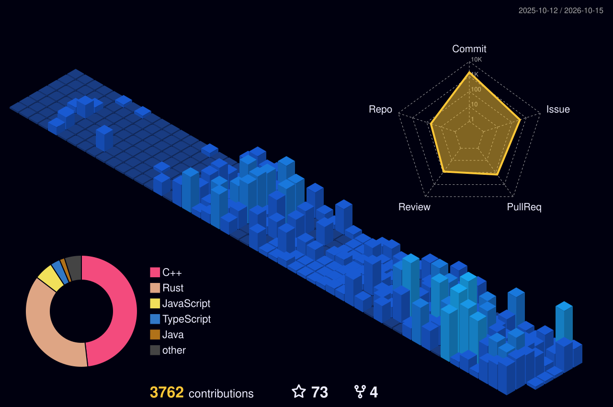

<!-- HEADER -->

# 👋 Hey, I’m **Canberk**  
### Crafting high-performance systems, engines & modern software  

 

<!-- BADGES -->

  
  
  

---

<!-- INTRO -->
## 🧩 About Me

I’m **Canberk**, a multidisciplinary developer passionate about building **fast**, **efficient**, and **deeply engineered** systems.  
I love understanding how things work under the hood — from CPU instructions to real-time rendering pipelines.

My expertise covers:

- ⚙ **C++**, **Rust**, **C#** — performance, engines, low-level development  
- 🎮 Real-time systems, engine architecture, rendering fundamentals  
- 🧵 Concurrent programming, memory management, systems design  
- 🌐 Backend & cross-platform application development  
- 🐧 Linux power-user — Arch + Hyprland  
- 🚀 Building tools, frameworks, and custom solutions from scratch

I’m driven by the idea of creating **high-quality, clean, and scalable software** that feels great to build and even better to use.

---

## 🛠 Tech Stack

### **Languages**

### **Tools**

### **Frameworks**

### **Technologies**
 

  &nbsp;
  &nbsp;
  &nbsp;

---

## 🖥️ Featured Skillset Highlights

- 🔹 High-performance C++ & Rust systems  
- 🔹 Engine architecture & rendering pipelines  
- 🔹 Multithreading, concurrency & memory optimization  
- 🔹 Backend logic, networking, protocol design  
- 🔹 UI/UX for desktop applications  
- 🔹 Linux customization, WM setups, tooling automation  

---

## 🎨 I use Arch btw

    
  <h3>By the way… I use Arch, and Hyprland ✨</h3>
  

---

## What I'm building

<table>
<tr>
<td width="33%" valign="top">

<b><a href="https://github.com/CanReader/SleakEngine">SleakEngine</a></b> 
C++23 engine with DirectX 11, DirectX 12, OpenGL and Vulkan behind one rendering interface. <a href="https://github.com/CanReader/SleakCraft">SleakCraft</a> is a voxel sandbox built on it.
</td>
<td width="33%" valign="top">

<b><a href="https://github.com/CanReader/RustVK">RustVK</a></b> 
A modular Vulkan renderer in Rust on raw <code>ash</code> bindings. No wrappers between me and the spec.
</td>
<td width="33%" valign="top">

<b><a href="https://github.com/CanReader/NavLab">NavLab</a></b> 
Pathfinding you can watch: A*, jump point search, flow fields, and a polygon navmesh with funnel smoothing.
</td>
</tr>
</table>

| Project | What it is |
|---|---|
| [**Tactix**](https://github.com/CanReader/Tactix) | Game AI plugin for Unreal Engine 5: Utility AI, GOAP, HTN, cover, influence maps, squads and formations |
| [**FastNN**](https://github.com/CanReader/FastNN) | Deep learning library in Rust with CUDA kernels. Autograd, transformers, KV-cached generation, all from scratch. [Try it in the browser](https://github.com/CanReader/fastnn-visualizer) |
| [**ViewCam**](https://github.com/CanReader/ViewCam-Desktop) | Turns your phone into a wireless webcam. Qt 6 desktop app plus an Android client |
| [**StealthDemo**](https://github.com/CanReader/StealthDemo) | Stealth enemy AI in UE5 with behavior trees, services and C++ tasks |
| [**Evo-Engine**](https://github.com/CanReader/Evo-Engine) | Evolutionary computation in Rust: GA, DE, CMA-ES, NSGA-II, island models |
| [**raft-kv**](https://github.com/CanReader/raft-kv) | Distributed key-value store on Raft, with gRPC and RocksDB |
| [**rustfm**](https://github.com/CanReader/rustfm) · [**ZipRS**](https://github.com/CanReader/ZipRS) | A terminal file manager and a desktop archive manager, both in Rust |

## Worth bookmarking

- [**game-ai-cheatsheet**](https://github.com/CanReader/game-ai-cheatsheet): which game AI technique to use and why. FSMs, behavior trees, utility AI, GOAP, HTN, steering, A*, JPS, flow fields, navmeshes and influence maps, each with a small tested implementation.
- [**graphics-interview-questions**](https://github.com/CanReader/graphics-interview-questions): 192 graphics, rendering and engine programming questions with short answers that explain why.

## Want to contribute?

[FastNN](https://github.com/CanReader/FastNN) is part of Hacktoberfest this year.
The issues labelled [`good first issue`](https://github.com/CanReader/FastNN/issues?q=is%3Aopen+label%3A%22good+first+issue%22)
each point at the exact file and line and say what a fix looks like, and most
don't need a GPU. [Start here](https://github.com/CanReader/FastNN/issues/56).

---

## 🔥 GitHub Stats

 

---

## 🏆 GitHub Trophies  

  <a href="https://github.com/CanReader">
    <picture>
      <source media="(prefers-color-scheme: dark)" srcset="https://github-trophies.devomb.com/?username=CanReader&no-bg=true&row=2&column=6&margin-w=20&margin-h=20&theme=monokai">
      <source media="(prefers-color-scheme: light)" srcset="https://github-trophies.devomb.com/?username=CanReader&no-bg=true&row=2&column=6&margin-w=20&margin-h=20">
      
    </picture>
  </a>

  

---

## 🧊 3D Contribution Calendar

  <picture>
    <source media="(prefers-color-scheme: dark)" srcset="./profile-3d-contrib/profile-night-view.svg">
    <source media="(prefers-color-scheme: light)" srcset="./profile-3d-contrib/profile-season-animate.svg">
    
  </picture>

